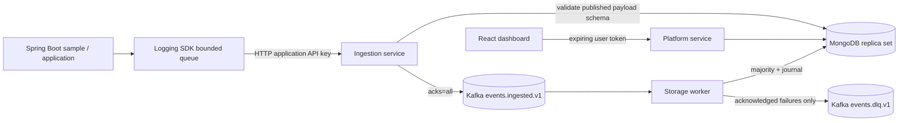

# Architecture



```mermaid
sequenceDiagram
  participant SDK
  participant Ingestion
  participant Kafka
  participant Worker
  participant Mongo
  SDK->>Ingestion: Batch; stable eventIds
  Ingestion->>Mongo: Resolve credential and published schema
  Ingestion->>Kafka: Produce validated envelopes
  Kafka-->>Ingestion: Producer acknowledgment
  Ingestion-->>SDK: Per-event accepted / rejected / retryable
  Kafka->>Worker: Batch records
  Worker->>Mongo: Unordered bulk inserts; majority+journal
  Mongo-->>Worker: Success or indexed partial results
  Worker->>Kafka: Commit only after all records resolved
```

The platform is one service with controllers for authentication, management, and structured queries. It deliberately does not split schemas, auth and dashboards into more microservices. The ingestion and worker independently access Mongo; this keeps schema/credential resolution simple and avoids synchronous internal HTTP dependencies. Application credential revocation is checked on every batch. User membership is checked on every authenticated request.

Users, tenant memberships and expiring sessions are separate collections. Application API credentials have their own `api_keys` collection, containing only SHA-256 hashes of cryptographically random secrets. Passwords use BCrypt cost 12; opaque user tokens expire after 8 hours and only their hashes are stored. Active membership determines the tenant; login's optional tenant selector must match a real membership. Browser session storage holds the bearer token until logout or tab/session termination.

Mongo collections: `events`, `event_schemas`, `dashboards`, `applications`, `users`, `memberships`, plus `tenants`, `api_keys`, `sessions`. Startup creates unique identity indexes and session/event TTL indexes. Worker event indexes are established before Kafka listener startup. Arbitrary custom payload fields are not automatically indexed.

## Version choices and official references

Concrete versions are in Maven POMs, `frontend/package.json`/lockfile and Compose. Spring Boot 3.5.16 manages Spring Framework, Spring Security, Spring Kafka and Mongo driver compatibility. Java compilation targets 21; the local host may run a newer JDK. Runtime images use Temurin 21.0.8. Kafka is 4.0.1 in KRaft mode; MongoDB is 8.0.15. JSON Schema uses networknt 1.5.9 with draft 2020-12. Testcontainers is 1.21.3. Frontend uses React 18.3.1, TypeScript 5.7.3, Vite 6.4.4, Tailwind 4.1.14, Recharts 3.6.0 and react-grid-layout 1.5.4.

References consulted during implementation:

- [Spring Boot 3.5 system requirements](https://docs.spring.io/spring-boot/3.5/system-requirements.html): Java 21 compatibility, Maven requirements.
- [Spring Kafka error handling](https://docs.spring.io/spring-kafka/reference/kafka/annotation-error-handling.html): batch retries, pausing and commit semantics.
- [Kafka producer configuration](https://kafka.apache.org/40/configuration/producer-configs/): idempotence and acknowledgment requirements.
- [networknt JSON Schema validator](https://github.com/networknt/json-schema-validator): supported dialects and Java/Jackson library families.
- [Vite setup](https://vite.dev/guide/): Node requirements.

These versions are a tested local combination, not a promise that every dependency is the latest release. Reassess patches and image digests before deployment.
